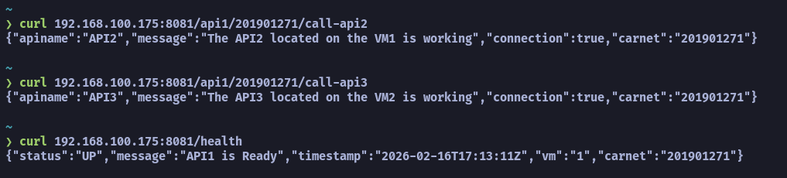
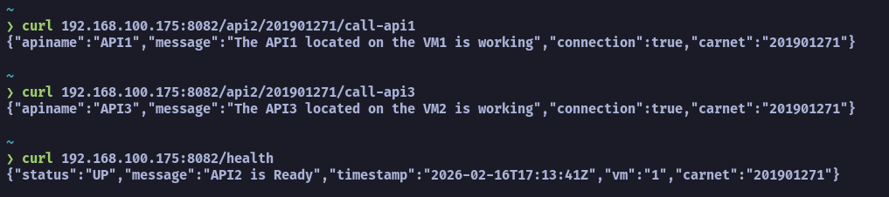
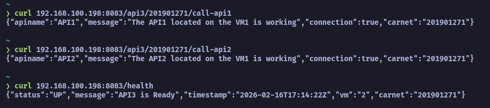
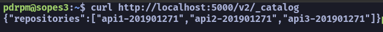
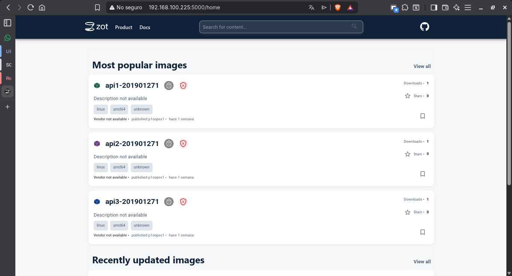

# Manual Técnico

## Proyecto 1 - Sistemas Operativos 1

**Nombre:** Luis Pedro Pérez Monzón

**Carné:** 201901271

### Diagrama de Arquitectura


### Funcionamiento de las APIs

#### Endpoints

**`GET /health`**

- Descripción: Verifica el estado de la API.
- Respuesta:

    ```json
    {
        "status": "UP",
        "message": "API# is Ready",
        "timestamp": "2026-02-16T12:00:00Z",
        "vm": "1",
        "carnet": "201901271"
    }
    ```

**`GET /api#/201901271/call-api#`**

- Descripción: Llama a la API y devuelve un mensaje con la respuesta del servidor.
- Respuesta:

    ```json
    {
        "status": "UP",
        "message": "API# is Ready",
        "timestamp": "2026-02-16T17:13:41Z",
        "vm": "1",
        "carnet": "201901271"
    }
    ```

#### Capturas

**API1:** Request a `GET /health`, `GET /api1/201901271/call-api2` y `GET /api1/201901271/call-api3`


**API2:** Request a `GET /health`, `GET /api2/201901271/call-api1` y `GET /api2/201901271/call-api3`


**API3:** Request a `GET /health`, `GET /api3/201901271/call-api1` y `GET /api3/201901271/call-api2`


**Contenedor de Zot**


**Interfaz de Zot**


### Configuración de Máquinas Virtuales

**SO:** Ubuntu Server 24.04 LTS
**CPU:** 2 vCPU  
**RAM:** 2 GB  
**Disco Duro:** 15 GB


### Instalación

1. Instalar Containerd en las máquinas virtuales 1 y 2:

```bash
sudo apt update
sudo apt install -y containerd
sudo systemctl start containerd
sudo systemctl enable containerd
```

2. Instalar Docker en la máquina virtual 3:

```bash
sudo apt update
sudo apt install -y docker.io
sudo systemctl start docker
sudo systemctl enable docker
```

3. Crear un container usando la imagen de zot en la máquina virtual 3:

```bash
docker run -p 5000:5000 ghcr.io/project-zot/zot:latest
```

4. Clonar el repositorio del proyecto en la máquina virtual 3 y entrar al directorio del proyecto:

```bash
git clone https://github.com/LuisPerez99/201901271_LAB_SO1_1S2026.git
cd 201901271_LAB_SO1_1S2026
```

5. Crear el archivo .env para definir las variables de entorno necesarias para las APIs:
    - **PORT_API1:** Puerto para la API1 (ejemplo: 8081)
    - **HOST_API1:** Host para la API1 (En este caso, localhost o la IP de la máquina virtual 1, ejemplo: 192.168.1.203)
    - **PORT_API2:** Puerto para la API2 (ejemplo: 8082)
    - **HOST_API2:** Host para la API2 (En este caso, localhost o la IP de la máquina virtual 1, ejemplo: 192.168.1.203)
    - **PORT_API3:** Puerto para la API3 (ejemplo: 8083)
    - **HOST_API3:** Host para la API3 (En este caso, localhost o la IP de la máquina virtual 2, ejemplo: 192.168.1.204)

6. Ejecutar docker build para construir las imágenes de las APIs:

```bash
cd api1
docker build -t api1-201901271:latest .
cd ../api2
docker build -t api2-201901271:latest .
cd ../api3
docker build -t api3-201901271:latest .
```

7. Crear tags para las imágenes y subirlas al registro de zot:

```bash
# Crear tags para las imágenes
docker tag api1-201901271:latest localhost:5000/api1-201901271:latest
docker tag api2-201901271:latest localhost:5000/api2-201901271:latest
docker tag api3-201901271:latest localhost:5000/api3-201901271:latest
# Subir las imágenes al registro de zot
docker push localhost:5000/api1-201901271:latest
docker push localhost:5000/api2-201901271:latest
docker push localhost:5000/api3-201901271:latest
```

8. En las máquinas virtuales 1 y 2, ejecutar containerd para descargar las imágenes de las APIs desde el registro de zot:

```bash
# En la máquina virtual 1
sudo nerdctl pull localhost:5000/api1-201901271:latest
sudo nerdctl pull localhost:5000/api2-201901271:latest
# En la máquina virtual 2
sudo nerdctl pull localhost:5000/api3-201901271:latest
```

9. Crear contenedores para las APIs en las máquinas virtuales 1 y 2:

```bash
# En la máquina virtual 1
sudo nerdctl run -d -p 8081:8081 --name api1-201901271 localhost:5000/api1-201901271:latest
# En la máquina virtual 2
sudo nerdctl run -d -p 8082:8082 --name api2-201901271 localhost:5000/api2-201901271:latest
# En la máquina virtual 3
sudo nerdctl run -d -p 8083:8083 --name api3-201901271 localhost:5000/api3-201901271:latest
```