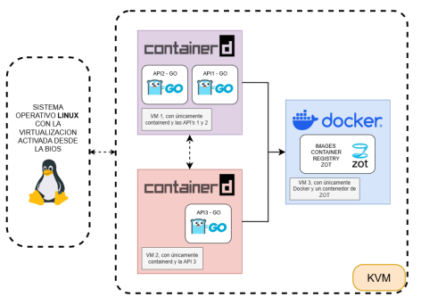
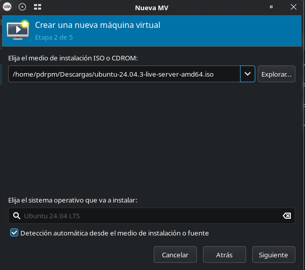
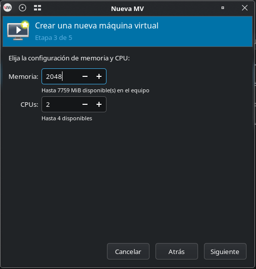
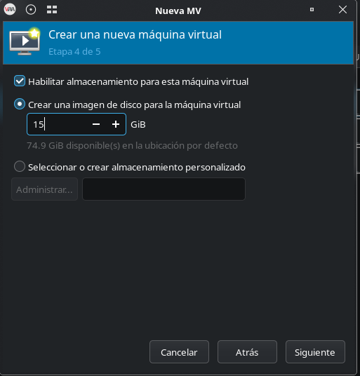
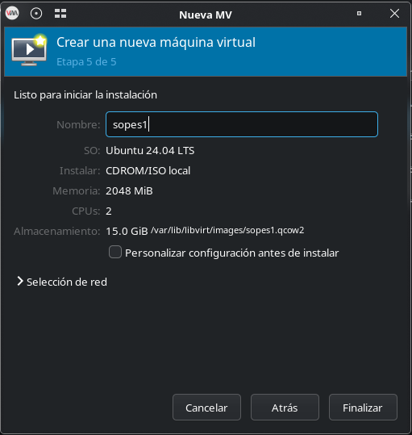

# Manual Técnico

## Proyecto 1 - Sistemas Operativos 1

**Nombre:** Luis Pedro Pérez Monzón

**Carné:** 201901271

### Diagrama de Arquitectura



### Funcionamiento de las APIs

#### Endpoints

**`GET /health`**

- Descripción: Verifica el estado de la API.
- Respuesta:

    ```json
    {
        "status": "ok",
        "message": "API is healthy"
    }
    ```

**`GET /api#/201901271/call-api#`**

- Descripción: Llama a la API y devuelve un mensaje con la respuesta del servidor.
- Respuesta:

    ```json
    {
        "message": "Hello from the API!"
    }
    ```

### Configuración de Máquinas Virtuales

**SO:** Ubuntu Server 24.04 LTS
**CPU:** 2 vCPU  
**RAM:** 2 GB  
**Disco Duro:** 15 GB








