# Documentación

## Proyecto 2 - Sistemas Operativos 1

**Nombre:** Luis Pedro Pérez Monzón

**Carné:** 201901271

## Manual Técnico

### Diagrama de Arquitectura

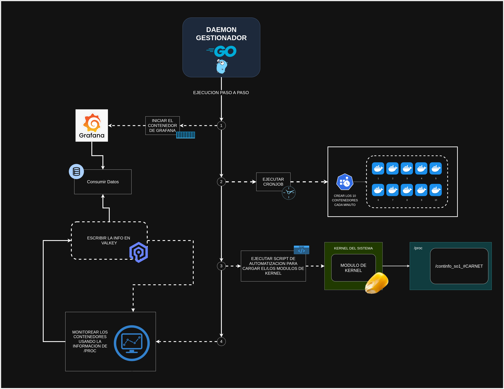

### Funcionamiento del Daemon

- Se inicia con el script `iniciar_daemon.sh`, que ejecuta el daemon en segundo plano, este se debe ejecutar como superusuario para que pueda acceder a los recursos necesarios, los logs se almacenan en el archivo `daemon.log` para monitorear su actividad y depurar cualquier problema que pueda surgir.

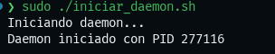

- El servicio verifica si los contenedores con grafana y valkey están activos, si no lo están, los inicia utilizando el `docker-compose.yml`.

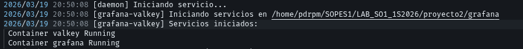

- El daemon ejecuta el cronjob (`cronjob/crear-containers.sh`) para crear 5 contenedores aleatorios cada 2 minutos, luego carga el módulo del kernel `modulo-kernel/build/continfo.ko` que proporciona información sobre los contenedores y los procesos del sistema, luego, se conecta a la base de datos de valkey.

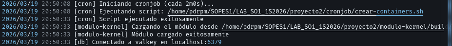

- Cada 20s el daemon lee la información del archivo `proc/continfo_pr2_so1_201901271` para determinar qué contenedores debe eliminar, deben haber 2 de alto consumo y 3 de bajo consumo, en caso de que no se cumpla esta condición, el daemon eliminará los contenedores que no cumplan con el criterio de consumo, en cada iteración guarda la información de los contenedores y el sistema en la base de datos de valkey.

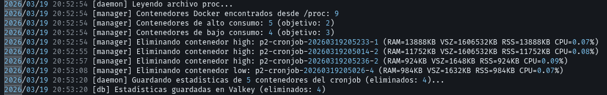

- El servicio se puede detener con el script `detener_daemon.sh`, que finaliza el proceso del daemon, al terminarlo, se detienen los contenedores de grafana y valkey, y se eliminan los contenedores creados por el cronjob.

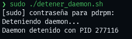

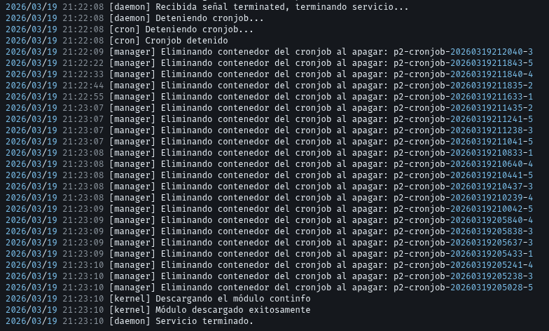

### Grafana y Base de Datos Valkey

Grafana se utiliza para visualizar los datos almacenados en la base de datos de valkey, que contiene información sobre el consumo de recursos de los contenedores y el sistema. Se pueden crear dashboards personalizados en Grafana para monitorear el rendimiento de los contenedores y detectar cualquier anomalía en el consumo de recursos.

- Los servicios de Grafana y Valkey se inician automáticamente con el daemon, pero también se pueden iniciar manualmente utilizando el comando `docker-compose up -d` en el directorio `grafana` dentro del proyecto.
    - Grafana estará disponible en `http://localhost:3000` con las credenciales por defecto (usuario: admin, contraseña: admin).
    - La base de datos de valkey se puede acceder a través del contenedor de valkey, utilizando el comando `docker exec -it valkey bash` para ingresar al contenedor y luego interactuar con la base de datos.

- El dashboard de grafana contiene tres secciones:
    - **Visión General del Sistema:** Muestra el consumo total de RAM, memoria en uso y memoria libre del sistema.
        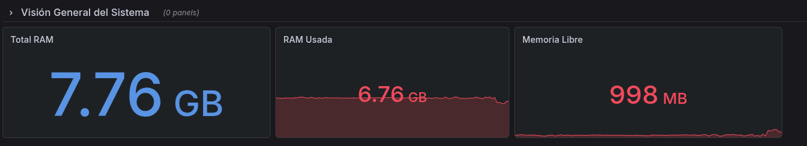
    - **Evolución Temporal:** Muestra el uso de RAM a lo largo del tiempo y el número de contenedores eliminados en cada iteración.
        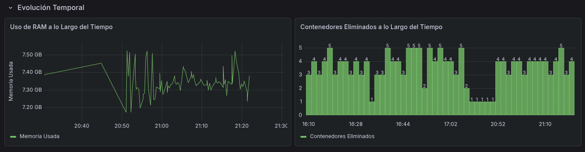
    - **Top Rankings:** Muestra los 5 contenedores con mayor consumo de RAM y los 5 contenedores con mayor consumo de CPU.
        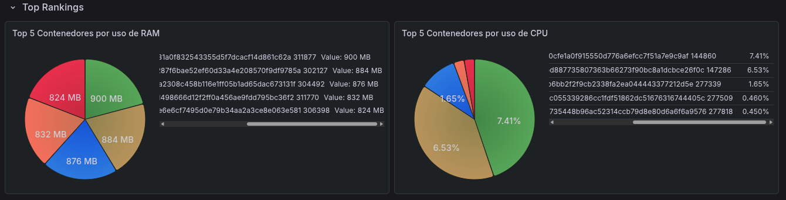

### Módulo del Kernel

El módulo del kernel `continfo.ko` se encarga de proporcionar información sobre los contenedores y los procesos del sistema. Este módulo se carga al iniciar el daemon y se utiliza para obtener datos sobre el consumo de recursos de los contenedores, que luego se almacenan en la base de datos de valkey. El módulo se puede compilar utilizando el comando `make` en el directorio `modulo-kernel`, y se carga automáticamente con el daemon, pero también se puede cargar manualmente utilizando el comando `insmod continfo.ko`.

La información obtenida por el módulo del kernel se almacena en el archivo `proc/continfo_pr2_so1_201901271`, que es leído por el daemon para determinar qué contenedores eliminar en cada iteración.

**Modulo cargado**

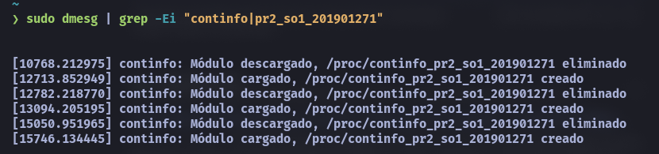

**Archivo proc**

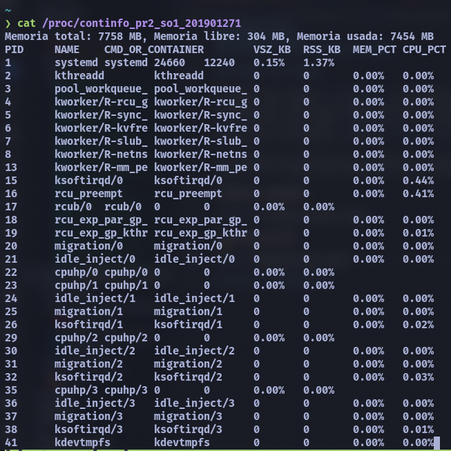

### Cronjob

El cronjob se encarga de crear 5 contenedores aleatorios cada 2 minutos, utilizando el script `crear-containers.sh` ubicado en el directorio `cronjob`. Este script genera contenedores con diferentes niveles de consumo de recursos (alto y bajo) para simular un entorno realista y permitir que el daemon tome decisiones sobre qué contenedores eliminar en función de su consumo. El cronjob se inicia automáticamente con el daemon, pero también se puede ejecutar manualmente utilizando el comando `bash crear-containers.sh` en el directorio `cronjob`, este se debe ejecutar como superusuario para que pueda crear los contenedores correctamente.

Imágenes usadas para crear los contenedores:

- Para los contenedores de alto consumo de RAM se utiliza la imagen `roldyoran/go-client`, que es una aplicación en Go diseñada para consumir una gran cantidad de memoria.
- Para los contenedores de alto consumo de CPU se utiliza la imagen `alpine`, que es una imagen ligera de Linux, y se ejecuta un comando que realiza cálculos intensivos para consumir CPU.
- Para los contenedores de bajo consumo de recursos se utiliza la imagen `alpine`, y se ejecuta un comando de sleep para simular un contenedor que consume pocos recursos.

Comandos ejecutados por el cronjob para crear contenedores:

- Contenedor de alto consumo de RAM:

```bash
docker run -d --name "<container_name>" --label app=pr2-cronjob roldyoran/go-client >/dev/null
```

- Contenedor de alto consumo de CPU:

```bash
docker run -d --name "<container_name>" --label app=pr2-cronjob alpine sh -c "while true; do echo '2^20' | bc > /dev/null; sleep 1; done" >/dev/null
```

- Contenedor de bajo consumo de recursos:

```bash
docker run -d --name "<container_name>" --label app=pr2-cronjob alpine sleep 240 >/dev/null
```

## Guía de Instalación

### Requisitos Previos

- Docker: Asegúrate de tener Docker instalado y funcionando en tu sistema. Puedes descargarlo desde [aquí](https://www.docker.com/get-started).
- Go: El daemon está escrito en Go, por lo que necesitarás tener Go instalado para compilarlo. Puedes descargarlo desde [aquí](https://golang.org/dl/).
- Permisos de superusuario: El daemon requiere permisos de superusuario para acceder a los recursos necesarios, así que asegúrate de tener acceso a una cuenta con privilegios de administrador.

1. Clonar el repositorio del proyecto:

```bash
git clone https://github.com/LuisPerez99/201901271_LAB_SO1_1S2026.git
cd 201901271_LAB_SO1_1S2026
```

2. Compilar el módulo del kernel:

```bash
cd modulo-kernel
make
cd ..
```

3. Entrar al directorio del daemon y compilarlo:

```bash
cd daemon
go build -o build/daemon ./src
```

4. Iniciar el daemon:

```bash
sudo ./iniciar_daemon.sh
```

5. Acceder a Grafana para visualizar los datos:

- Grafana estará disponible en `http://localhost:3000` con las credenciales por defecto (usuario: admin, contraseña: admin).

6. Para detener el daemon:

```bash
sudo ./detener_daemon.sh
```
