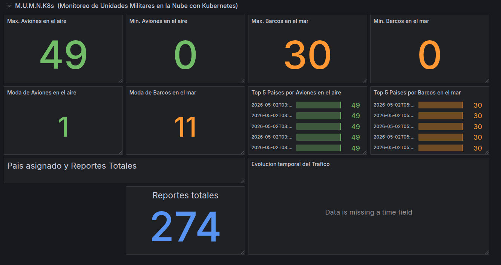

# Manual Técnico — Proyecto3 (Sistemas Operativos 1)

## Resumen
Este documento describe la arquitectura, el flujo de datos, la configuración y los procedimientos de despliegue para el proyecto Proyecto3. Incluye instrucciones sobre Gateway API, comunicaciones REST y gRPC, uso de RabbitMQ, despliegue de Valkey y Grafana sobre KubeVirt, configuración de HPA, publicación/consumo de imágenes desde Zot y las pruebas realizadas.

---

## 1. Arquitectura general

Componentes principales:
- `Gateway API` (entrada al cluster, balanceo y enrutamiento).
- `Rust API` (servicio principal backend REST).
- `Go gRPC server` (servicio gRPC para tareas específicas).
- `Go API client` y `Go consumer` (componentes cliente/consumidor).
- `RabbitMQ` (broker para mensajería asíncrona).
- `Zot` (registro OCI externo HTTPS ubicado en una VM GCP).
- `Valkey` y `Grafana` desplegados como VMs con KubeVirt.
- `HPA` (Horizontal Pod Autoscaler) para escalado horizontal.

Topología y comunicación:
- Clientes externos → Gateway API → Servicios dentro del namespace `proyecto3`.
- Servicios sincrónicos usan REST o gRPC según caso; operaciones asíncronas usan RabbitMQ.
- Las imágenes Docker se almacenan en Zot (VM GCP) accesible por GKE mediante HTTPS y autenticación básica.

Diagrama simplificado (texto):

Client
  │
  ▼
Gateway API (ingress) ──► `rust-api` (REST) ──► `go-grpc-server` (gRPC)
                           │
                           └─► publica mensajes ─► RabbitMQ ─► `go-consumer`

Zot (VM GCP, HTTPS) ←─ push/pull imágenes
Grafana/Valkey (KubeVirt VMs) ── monitoring / cache

---

## 2. Flujo completo de datos

Escenario típico (petición HTTP que desencadena trabajo asíncrono):
1. Un cliente realiza petición HTTP a `Gateway API` (ej. /api/v1/report).
2. `Gateway` enruta a `rust-api` en Kubernetes (service -> pod).
3. `rust-api` valida la petición, realiza operaciones internas y **sincrónicamente** puede llamar al `go-grpc-server` mediante gRPC para cálculos o métodos específicos.
4. Si la operación requiere procesamiento asíncrono (ej. generación de reporte largo): `rust-api` publica un mensaje en RabbitMQ (exchange + routing key).
5. `go-consumer` (o workers) consume desde RabbitMQ, procesa la tarea, actualiza estado en DB o publica eventos de resultado.
6. Los resultados pueden ser consultados por el cliente mediante endpoints REST o notificados por otro mecanismo.

Detalles técnicos:
- Mensajes en RabbitMQ deben ser durables para tolerar reinicios.
- Campos de tracing/log deben incluir `request_id` para seguimiento entre servicios (propagar en headers HTTP y metadata gRPC).

---

## 3. Configuración de Gateway API

Archivo de referencia: [k8s/08-gateway-api.yaml](k8s/08-gateway-api.yaml)

Puntos clave:
- Exponga `Gateway` en TLS (terminación TLS en el gateway) o haga passthrough hacia servicios si prefiere TLS end-to-end.
- Defina rutas HTTP al `rust-api` y al endpoint de salud.

Ejemplo mínimo (fragmento conceptual):

```yaml
apiVersion: networking.x-k8s.io/v1alpha1
kind: Gateway
metadata:
  name: proyecto3-gateway
  namespace: proyecto3
spec:
  gatewayClassName: contour
  listeners:
    - protocol: HTTPS
      port: 443
      tls:
        mode: Terminate
        certificateRef:
          name: proyecto3-cert
  routes:
    - kind: HTTPRoute
      name: proyecto3-routes
```

Recomendaciones:
- Use `readiness` y `liveness` probes en los Services para que Gateway retire pods no saludables.
- Para entornos locales con certificado autofirmado, configure los nodos y `docker` para confiar en el certificado de Zot cuando haga `docker login`.

---

## 4. Comunicación REST y gRPC

REST (HTTP/JSON):
- Usado para operaciones CRUD, endpoints públicos y control.
- Recomendaciones: validar JSON, usar códigos HTTP apropiados, y paginación para colecciones.

gRPC:
- Usado para comunicación interna de baja latencia entre `rust-api` y `go-grpc-server` (o entre microservicios Go).
- Archivo proto de referencia: [proto/warreport.proto](proto/warreport.proto)

Ejemplo de uso gRPC en Rust (concepto):
- El cliente Rust crea un stub gRPC con la dirección del servicio (service:port) dentro del cluster.
- Pasar metadata (por ejemplo `request-id`) en cada llamada.

Versionado y compatibilidad:
- Mantenga backward-compatible changes en `.proto` (añadir campos con números nuevos, no renombrar ni reutilizar números).

---

## 5. Uso de RabbitMQ

Roles:
- Encolado de tareas asíncronas (jobs), buffering y desacoplo entre productores y consumidores.

Recomendaciones de configuración:
- Use exchanges de tipo `topic` o `direct` según necesidad.
- Declare colas como `durable=true`, mensajes `delivery_mode=2` para persistencia.
- Habilite autenticación y TLS para conexiones remotas si aplica.

Ejemplo de publicación (pseudocódigo):

```python
# Producer
channel.exchange_declare(exchange='reports', exchange_type='topic', durable=True)
channel.basic_publish(
  exchange='reports',
  routing_key='reports.generate',
  body=json.dumps(payload),
  properties=BasicProperties(delivery_mode=2)
)
```

Ejemplo de consumo:

```python
# Consumer
channel.basic_consume(queue='reports_worker', on_message_callback=callback, auto_ack=False)
```

Buenas prácticas:
- Acknowledge manual (`ack`) al finalizar procesamiento exitoso.
- Implementar reintentos con backoff y DLQ (dead letter queues) para mensajes que fallan repetidamente.
- Monitorizar colas y tasas con herramientas (RabbitMQ Management, métricas Prometheus si está disponible).

---

## 6. Despliegue de Valkey y Grafana sobre KubeVirt

Contexto:
- Se usan VMs provisionadas por KubeVirt para Valkey (servicio de cache/llaves) y Grafana para visualización.
- Archivos de despliegue: [k8s/09-kubevirt-valkey.yaml](k8s/09-kubevirt-valkey.yaml) y [k8s/10-kubevirt-grafana.yaml](k8s/10-kubevirt-grafana.yaml)

Pasos generales:
1. Asegurar que KubeVirt está instalado y funcionando en el cluster GKE.
2. Crear `VirtualMachine` resources con discos y recursos necesarios.
3. Exponer servicios (ClusterIP/NodePort) para acceder a Grafana o crear un `Gateway` para acceso externo.

Consideraciones:
- Para persistencia de Grafana use PVCs montadas en la VM o use almacenamiento dentro de la VM según tolerancia.
- Backup de dashboards en caso de reprovisión de VMs.

---

## 7. Configuración de HPA

Archivo de referencia: [k8s/07-hpa.yaml](k8s/07-hpa.yaml)

Conceptos:
- HPA escala los `replicas` de un `Deployment` según métricas (CPU, memoria, o métricas custom via Metrics Server / Prometheus Adapter).

Ejemplo (conceptual):

```yaml
apiVersion: autoscaling/v2
kind: HorizontalPodAutoscaler
metadata:
  name: rust-api-hpa
  namespace: proyecto3
spec:
  scaleTargetRef:
    apiVersion: apps/v1
    kind: Deployment
    name: rust-api
  minReplicas: 1
  maxReplicas: 3
  metrics:
    - type: Resource
      resource:
        name: cpu
        target:
          type: Utilization
          averageUtilization: 50
```

Recomendaciones:
- Configure `requests` y `limits` de recursos en los pods para que HPA pueda estimar el uso.
- Para escalado por latencia o colas (RabbitMQ backlog) use métricas custom conectadas con Prometheus Adapter.

---

## 8. Publicación/consumo de imágenes desde Zot

Zot está desplegado en una VM GCP con HTTPS obligatorio.

Pasos para publicar imágenes (push):
1. Iniciar sesión en Zot desde la máquina que hace push: 

```bash
export ZOT_HOST=<IP_O_DOMINIO_VM>
export ZOT_USER=admin
export ZOT_PASS=TU_PASS
docker login ${ZOT_HOST}:5000 -u ${ZOT_USER} -p ${ZOT_PASS}
```

2. Tag y push:

```bash
docker build -t ${ZOT_HOST}:5000/api-rust:201901271 ./api
docker push ${ZOT_HOST}:5000/api-rust:201901271
```

Configuración HTTPS:
- Zot en VM debe tener `cert.pem` y `key.pem` en rutas configuradas en `config.json` y el puerto 5000 abierto.
- En nodos que hacen `docker pull` desde GKE, si el certificado es autofirmado, importe el CA o cert en los nodos/clúster para evitar errores TLS.

Pull desde Kubernetes:
- Cree un `Secret` tipo `docker-registry` en Kubernetes:

```bash
kubectl create secret docker-registry zot-regcred \
  --docker-server=${ZOT_HOST}:5000 \
  --docker-username=admin \
  --docker-password=TU_PASS \
  -n proyecto3
```

- Referenciar `imagePullSecrets` en los `Deployment`.

---

## 9. Pruebas realizadas y conclusiones

Pruebas realizadas:
- Verificación de endpoints de salud (`/health`) en `rust-api` con `curl`.
- Push/pull de imágenes a Zot y despliegue en GKE (ver logs de `kubectl describe pod`).
- Pruebas de mensajería: publicar jobs en RabbitMQ y verificar consumo por `go-consumer`.
- Prueba de gRPC: llamadas entre `rust-api` y `go-grpc-server` validando compatibilidad del proto.
- Pruebas de carga básicas con `locust` (ver `locust/locustfile.py`) para medir latencias y observar comportamiento del HPA.

Conclusiones:
- Zot funciona como registro HTTPS externo, asegurar que GKE confíe en su certificado para despliegues automáticos.
- RabbitMQ permite desacople; implementar DLQ y métricas para producción.
- gRPC es adecuado para comunicación interna de baja latencia; mantener versionado de `.proto`.
- KubeVirt es útil para correr Valkey y Grafana como VMs, pero requiere gestión adicional de backups y red.
- HPA necesita métricas correctas (`requests`/`limits`) y/o métricas custom para un escalado efectivo.

---

## 10. Dashboard de Grafana



---

## Apéndices

- Archivos de interés en el repositorio:
  - [k8s/02-rust-api.yaml](k8s/02-rust-api.yaml)
  - [k8s/07-hpa.yaml](k8s/07-hpa.yaml)
  - [k8s/08-gateway-api.yaml](k8s/08-gateway-api.yaml)
  - [proto/warreport.proto](proto/warreport.proto)
  - [docs/zot-config.json](docs/zot-config.json)


---